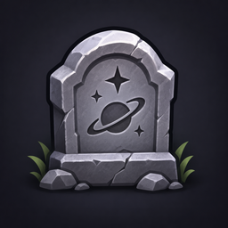
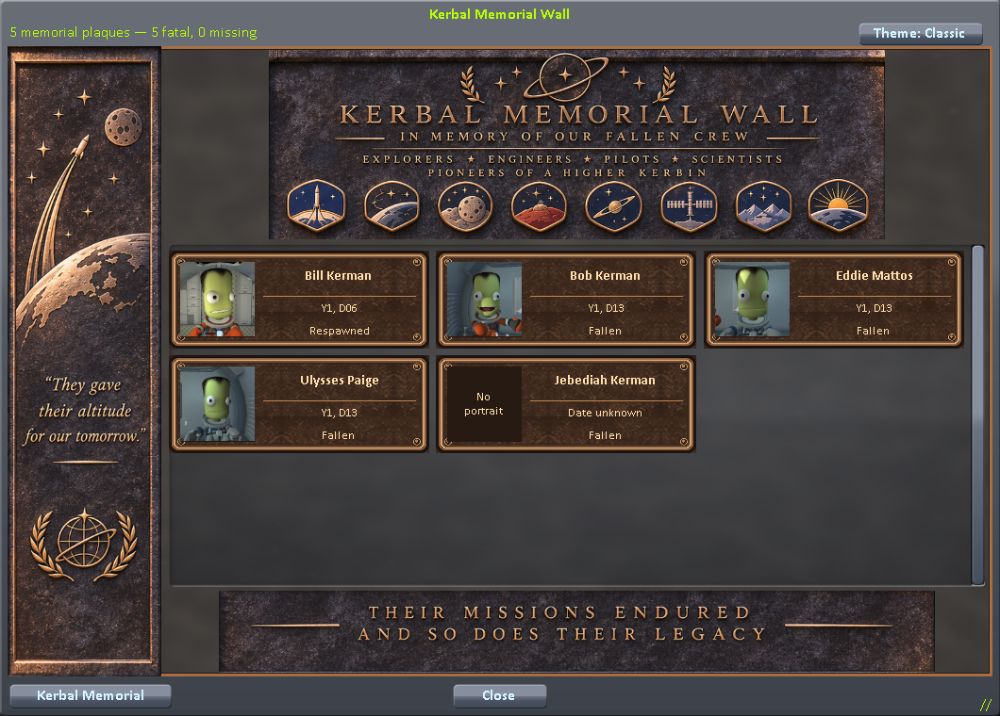
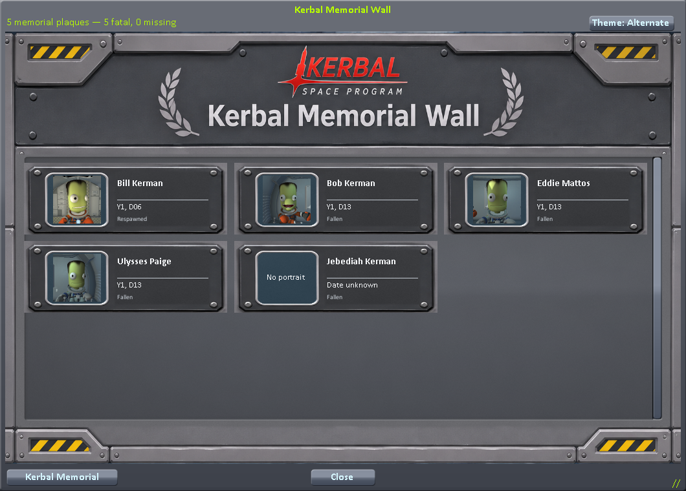

# Kerbal Memorial

**Kerbal Memorial** is a Kerbal Space Program 1 mod that remembers the Kerbals who didn't make it home.

The mod automatically tracks crew losses, records what happened, and creates memorial plaques displaying the Kerbal's portrait, name, date of death, and a memorial inscription. It also keeps detailed accident records, casualty statistics, and optional permanent archives that survive quickloads and reverts.

A **"Days Since Last Accident"** safety sign can be displayed in the VAB and SPH, and additional outdoor signs can be placed around the KSC.

KRASH simulations are ignored automatically, and other mods can report confirmed fatalities through an optional integration API.

---

# Quick Start

When a Kerbal dies, Kerbal Memorial can automatically display a memorial plaque.

### Default behavior

- Plaques appear **1.5 seconds** after a confirmed death.
- Plaques fade in and out over **2 seconds**.
- Multiple casualties are queued and displayed one after another.
- Flight Results are delayed until all memorial notifications have finished.

You can adjust or disable this behavior in **Settings / Help** or through the stock difficulty settings.

Manually opened plaques always appear immediately.

KRASH simulations, imported historical records, and previously recorded incidents do not generate popup notifications.

---

# Opening the Memorial


Open the Memorial Wall from either:

- The stock Application Launcher
- The Blizzy toolbar




The Memorial Wall is fully movable and resizable.

Select **Kerbal Memorial** at the bottom of the wall to open the main ledger, where you can:

- Browse fatalities, missing Kerbals, returned Kerbals, and respawned Kerbals
- View accident details
- Add personal notes
- Review statistics
- Configure accident signs
- Export data to CSV

---

# Memorial Wall

| Image 1 Title | Image 2 Title |
| :---: | :---: |
|   |   |


The Memorial Wall replaces the fictional plaques from the original artwork with real memorials generated from your save.

Each plaque can display:

- Portrait
- Name
- Status
- Date of loss
- Memorial inscription

You can scroll through all recorded casualties and active missing-person records.

Returned missing Kerbals are excluded from the wall, while respawned Kerbals remain part of the historical record.

## Themes

Two visual themes are available:

- **Classic**
- **Alternate (Industrial Metal)**

Themes can be changed from either:

- The Memorial Wall
- **Settings / Help**

---

# Individual Memorial Plaques

Clicking a plaque opens an individual memorial view containing:

- Portrait
- Name
- Status
- Date of loss
- Memorial inscription

Selecting **Details** opens a separate information window with:

- Full casualty information
- Flight history
- Editable notes
- Additional accident data

Closing the wall closes all associated plaque windows. Closing the details window leaves the memorial plaque open.

---

# Casualty Information

The main casualty view starts in compact mode and displays:

- Kerbal name
- Status
- Portrait
- Date of loss
- Cause
- Evidence
- Vessel
- Part
- Celestial body

Enable **Show Full Details** to reveal:

- Additional event information
- Flight history
- Editable notes

Your preferred view is remembered while browsing records.

---

# Portrait Capture

Kerbal Memorial attempts to preserve actual in-game crew portraits.

The system:

- Waits for valid crew portraits to become available
- Rejects static or corrupted images
- Preserves previously captured portraits
- Stores portraits directly in the save file

If a Kerbal dies before a valid portrait can be captured, no portrait may be available for that record.

Portraits cannot be reconstructed after death if no usable image was ever captured.

---

# Memorial Inscriptions

Each memorial receives a randomly selected inscription appropriate to the casualty's status.

## Custom inscription locations

### Fatalities

```text
GameData/KerbalMemorial/PluginData/Inscriptions/Deceased/
```

### Missing Kerbals

```text
GameData/KerbalMemorial/PluginData/Inscriptions/Missing/
```

## Rules

- One inscription per line
- Blank lines are ignored
- Markdown formatting is stripped
- Duplicate entries count only once

The mod cycles through available inscriptions without repeating them until every inscription has been used.

### Fallback text

If no missing inscription is available:

> Missing, but not forgotten

If no deceased inscriptions are available, the original notes remain visible.

---

# Days Since Last Accident Sign

Kerbal Memorial includes a safety sign that displays the number of in-game days since the most recent incident.

The sign appears in:

- Vehicle Assembly Building (VAB)
- Space Plane Hangar (SPH)

## Features

- Live accident-day tracking
- Adjustable size
- Adjustable height
- Wall-mounted or freestanding layouts
- Separate settings for VAB and SPH

Changes update immediately and are saved automatically.

---

# Outdoor Signs

Optional outdoor accident signs can be placed throughout the Kerbal Space Center.

## Included locations

- VAB
- SPH
- Tracking Station
- Mission Control
- Administration Building
- Astronaut Complex
- R&D Main Building
- R&D Central Building

These signs display the same accident-day counter used indoors.

## Configuration

Signs can be adjusted from:

**Kerbal Memorial → Outdoor Signs**

or

**Settings / Help → Outdoor Accident Sign Settings**

You can modify:

- Position
- Rotation
- Offsets
- Width (1–5 m)
- Height above ground (0.1–10 m)
- Wall or Posts mounting

Position, X/Y offsets and rotation are hidden by default. Enable **Show position and rotation** at the top of the outdoor settings window to display these fields and their explanatory text. Width, height and mounting remain visible.

Changes are applied in real time; Save or Close preserves them. Wall mounting removes the posts; use the existing placement controls to align the board with the wall. Indoor settings are available under **Settings / Help → Indoor Accident Sign Settings**.

Additional sign locations can be added through configuration files without recompiling the mod.

---

# Statistics and Exports

Kerbal Memorial maintains comprehensive safety records, including:

- Fatalities
- Missing crew
- Returned personnel
- Respawned crew
- Casualty timelines
- Incident causes

Statistics follow the active save's calendar system.

## CSV Export

Exports are written to:

```text
<savename>/KerbalMemorial/
```

All visible records are included, regardless of filtering.

---

# Save Modes

## Save-Game Mode (Default)

Records are stored directly in the save file and follow normal quickload and revert behavior.

## Permanent History Mode

Permanent History stores records separately in:

```text
saves/<save>/KerbalMemorial/Casualties.cfg
```

This archive survives quickloads and reverts.

### Notes

- Repeating a fatal mission after a revert creates a new incident.
- Reloading an already-recorded incident does not create duplicates.
- Archived records are labeled **Archived**.
- Disabling Permanent History only hides the archive; it does not delete it.

---

# How Fatalities Are Recorded

A death is recorded only when there is clear evidence that a Kerbal has died.

Examples include:

- Crew-killed events
- Dead roster status
- Confirmed reports from supported mods

A Kerbal marked only as **Missing** is not considered dead.

If a missing Kerbal later returns alive, their status becomes **Returned**.

Respawned Kerbals remain in history as past casualties.

---

# Imported Historical Casualties

Kerbal Memorial can import previously deceased or missing Kerbals.

Imported records contain:

- Unknown dates
- Unknown circumstances
- No popup notifications

If stock KSP has already removed a Kerbal from its records, that Kerbal cannot be reconstructed.

---

# Cause Classification

Kerbal Memorial attempts to identify likely causes of death using stock KSP events.

Supported classifications include:

- Overheating
- Excessive G-forces
- Over-pressure
- Ground impact
- Splashdown impact
- Vessel collisions
- Part failures
- Joint failures

EVA incidents receive specialized classifications when sufficient evidence exists.

> These classifications are best-effort approximations, not definitive accident investigations.

External API reports always take priority over automatic classification.

---

# Mod Integration

Other KSP mods can report fatalities directly to Kerbal Memorial.

Include:

```text
Integration/KerbalMemorialWrapper.cs
```

in your project.

## Example

```csharp
using KerbalMemorialIntegration;

bool recorded =
    KerbalMemorialWrapper.ReportDeath(
        crew,
        "Life support failure",
        "YourModName");
```

The API records a casualty only. It does **not**:

- Kill the Kerbal
- Change gameplay
- Modify save data outside the memorial system

KRASH simulations are excluded automatically.

---

# Life Support Mod Support

Kerbal Memorial does not currently include built-in adapters for life-support mods.

Planned integrations include:

- IFI Life Support
- KickLifeSupport
- Snacks
- TAC Life Support
- USI-LS

These integrations would allow those mods to report confirmed fatalities directly to the memorial tracker.

---

# What Kerbal Memorial Does Not Do

Kerbal Memorial is entirely passive.

It does **not**:

- Change game difficulty
- Modify roster behavior
- Alter physics
- Affect respawn rules
- Penalize the player
- Kill Kerbals

Its sole purpose is to record, preserve, and memorialize the history of your space program.